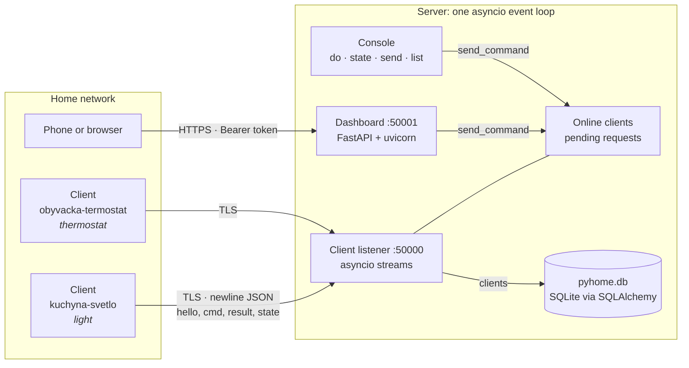
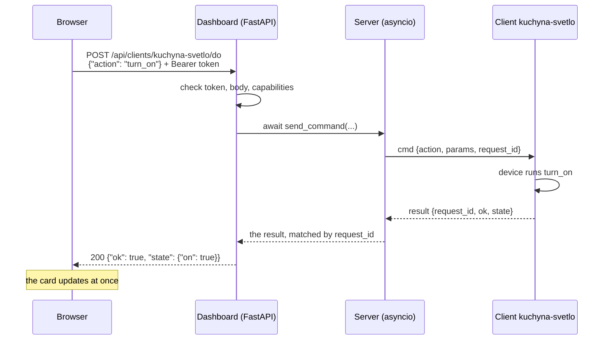

# pyhome

[](https://github.com/Fxdvs/pyhome/actions/workflows/tests.yml)

A small smart home system written in Python: one server, many clients, and a web
dashboard. The server accepts client connections over TCP, keeps track of who is
online, and serves a dashboard. Clients and the server exchange messages in both
directions.

Both sides run as a console application with their own command prompt.

**Status:** server and client `1.4`, see [Known limitations](#known-limitations).

## Architecture



The server is one process and one asyncio event loop. The client listener, the
FastAPI dashboard and the console prompt all run in it through
`asyncio.gather`, so a browser action awaits the very same `send_command`
the console's `do` uses, with no threads and no queues between them. Each
client is its own process, on the server's computer or anywhere in the house,
and needs nothing beyond the standard library.

What happens when the dashboard switches a light:



Several commands can be in flight at once: each `cmd` carries a
`request_id`, and the server completes the waiting request whose id the
`result` names.

## Requirements

- Python 3.10 or newer
- `fastapi` and `uvicorn` for the server, `sqlalchemy` for its database, `cryptography` for its certificate tool. The client needs nothing beyond the
  standard library.

```
py -m pip install -r requirements.txt
```

- `pywebview` for the desktop launcher, which needs the system web view:
  Windows 10 and 11 have it (WebView2), Linux needs GTK with WebKit2 or Qt
  with WebEngine.

```
py -m pip install -r requirements-launcher.txt
```

## Configs and the token

The real configs are not in git: they hold the token. Git has
`server/data/config.example.json` and `client/data/config.example.json`, the
defaults with an empty token. When `data/config.json` is missing, the app (and
the launcher) copies the example to it on start and says so in one line. Edit
`config.json`, never the example; `git status` never shows it.

**Updating from v1.3 or older.** Git deletes `config.json` from the folder when
a pulled commit stops tracking it, so copy them aside first:

```
copy server\data\config.json server\data\config.mine.json
copy client\data\config.json client\data\config.mine.json
git pull
move server\data\config.mine.json server\data\config.json
move client\data\config.mine.json client\data\config.json
```

Configs that were never committed, such as `client/data/kuchyna-svetlo.json`,
are not touched by the pull.

## Running

On Windows, double click `launcher.pyw`. One dark window holds the server and
every client config in `client/data/` (the `*.example.json` templates
excepted):

- **the sidebar** lists them with a status dot: green running, gray stopped,
  red ended with an error. **Spustiť označené** starts the ticked ones, the
  server first, the clients two seconds later.
- **the console** shows the selected app's output with its colors, and the
  line under it types into that app, the same commands as in its own console
  (`do kuch turn_on`, `list`, `help`).
- **Zastaviť** asks the app to end the way a person would, `shutdown` and
  `y`, so the server closes its database cleanly; an app that does not end
  within 3 seconds is terminated.
- **+ Nový klient** and **Upraviť** open a form instead of JSON: the id is
  made from the name, the token and `ca.crt` come from the server on this
  computer, a wrong field is marked with the reason. **Nastavenia servera**
  has the ports, the token with **Vygenerovať**, and **Vytvoriť certifikáty**.
- **Hľadať servery** in the client form lists every pyhome server on the
  local network with its name, address, TLS and certificate fingerprint;
  picking one fills the address. For a server on another computer the form
  downloads its `ca.crt` and keeps it only when its fingerprint is the one
  the server announced; compare that fingerprint with the server's startup
  lines before trusting it.
- What is ticked and selected is remembered in `launcher/state.json`. Closing
  the window while apps run asks first.

Or start them separately, each in its own console:

```
cd server && start.bat
cd client && start.bat
```

A client can use another config file, which is how one checkout runs several
clients:

```
py app.py --config data/kuchyna-svetlo.json
```

A new config file only needs `NAME`, the network settings and, for a device, `DEVICE`, and
`TOKEN` when the server has one. If `ID` is missing or empty, the first run
takes it from the file name (`kuchyna-svetlo.json` becomes `kuchyna-svetlo`)
and writes it back into the file. A file name that is not a usable id, and
`config.json`, get 8 random hex characters instead. So the quickest new device
is: copy `config.example.json` to `<room>-<device>.json` and fill it in. The launcher
refuses configs that share an ID.

To keep strangers out, put the same `TOKEN` in the server's config and in every
client's config. A client with a missing or different token is refused with the
reason, and it stops retrying until you fix its config and type `reconnect` (which
re-reads the config, so a corrected `TOKEN` or address takes effect right away; a
changed `DEVICE` still needs a restart).

Generate a strong token with:

```
py -c "import secrets; print(secrets.token_urlsafe(16))"
```

Upgrade every client before setting `TOKEN` on the server: an older client does
not understand `denied` and keeps retrying instead of showing the reason.
Every `*.json` in `client/data/` and `server/data/config.json` is ignored by
git, so a token put there stays on your computer. Keep it out of the
`*.example.json` files, which are in git.

The server listens on TCP port `50000` for clients and prints the dashboard
address on startup, including the one other devices on the network can use:

```
Server#1 running on 0.0.0.0:50000
Dashboard running on http://localhost:50001
                     http://192.168.1.20:50001
```

If a port is taken, almost always by a server that is still running in
another window, the server stops before touching anything and says how to
find it:

```
✘ Port 50000 for the clients is already in use, probably by another pyhome server.
  Find it with: netstat -ano | findstr :50000
```

The last number on the `LISTENING` line is the process id, `taskkill /PID <id>`
ends it.

## Project structure

```
pyhome/
├── shared/                       code both sides use
│   ├── protocol.py               message framing and message types
│   ├── command_handler.py        loads commands, reads the console prompt
│   ├── config.py                 read and write data/config.json
│   ├── console.py                printing that redraws the prompt
│   ├── colors.py                 ANSI colors
│   ├── symbols.py                status symbols
│   ├── network.py                local address and reachability
│   └── commands/                 commands both sides have
├── server/
│   ├── app.py                    entry point, runs all handlers with asyncio.gather
│   ├── make_certs.py             makes the TLS authority and server certificate
│   ├── data/
│   │   ├── config.example.json   the template config.json is made from, in git
│   │   ├── config.json           server identity and network settings, not in git
│   │   ├── certs/                TLS files from make_certs.py, not in git
│   │   └── pyhome.db             the server's database, created at runtime, not in git
│   ├── web/index.html            dashboard page, renders itself from /api/clients
│   └── handlers/
│       ├── server_handler.py     opens the TCP listener
│       ├── store.py              the database: SQLAlchemy ORM over SQLite, the only module that knows SQL
│       ├── client_handler.py     one coroutine per connected client
│       ├── web_handler.py        FastAPI dashboard
│       ├── discovery.py          answers Find servers on UDP, never with the token
│       └── commands/             server only commands
├── client/
│   ├── app.py                    entry point
│   ├── devices/                  one package per kind of device (light, thermostat)
│   ├── data/config.example.json  the template config.json is made from, in git
│   ├── data/*.json               client identity and which server to reach, not in git
│   └── client_handlers/          named apart from the server's handlers, so pytest can import both
│       ├── connection_handler.py connects and reconnects, holds the socket
│       ├── message_handler.py    receives messages from the server
│       ├── device_handler.py     loads the device and runs its actions
│       └── commands/             client only commands
├── tests/                        pytest, run all with py -m pytest
├── .github/workflows/tests.yml   CI: the tests on Linux and Windows, Python 3.10 and 3.13
├── launcher/                     the desktop launcher
│   ├── core.py                   configs, ids, tokens, certificates
│   ├── runner.py                 runs an app with pipes, keeps its output, types into it
│   ├── discovery.py              asks the network which servers are there
│   ├── api.py                    what the page calls, through pywebview
│   ├── build_css.py              builds web/launcher.css with Tailwind's standalone CLI
│   ├── web/                      the page: index.html, app.js, tailwind.css and the built launcher.css
│   └── state.json                what is ticked and selected, not in git
└── launcher.pyw                  opens the launcher window
```

Server and client keep only what is genuinely their own. Everything that was the
same on both sides lives in `shared/`.

## Configuration

Both sides read `data/config.json`, or the file given with `--config`:

| Key | Description |
| --- | --- |
| `ID` | identifier, sent during the handshake, generated on first run when empty |
| `NAME` | display name |
| `TYPE` | `server` or `client`, sent as `role` in the handshake |
| `DEVICE` | client only, which device package to load from `client/devices/`, empty for none |
| `VERSION` | version string, shown in the window title |
| `HOST` | server: address to bind to. client: address to connect to |
| `PORT` | TCP port, `50000` by default |
| `TOKEN` | shared secret, the client sends it in `hello` and the dashboard asks for it. On the server, empty means every client is accepted and the dashboard is open, with a warning at startup |
| `WEB_HOST` | server only, address the dashboard binds to |
| `WEB_PORT` | server only, dashboard port, `50001` by default |
| `TLS_CERT`, `TLS_KEY` | server only, its certificate and key, relative to the config's folder. Empty for none |
| `HISTORY_DAYS` | server only, how many days of device history `pyhome.db` keeps, `90` by default, `0` keeps none |
| `DISCOVERY` | server only, `false` stops it answering the launcher's **Hľadať servery**. On by default |
| `DISCOVERY_PORT` | server only, the UDP port it answers on, `50002` by default. The launcher asks on the one in this checkout's server config |
| `TLS_CA` | client only, the authority certificate to trust, relative to the config's folder. Empty for none |

The server can rename itself at runtime with `data config edit name`.

### Data folder

Everything the server writes lives in the folder of the config it was started
with, `server/data/` by default:

| File | What |
| --- | --- |
| `config.json` | the server's settings |
| `certs/` | the TLS files from `make_certs.py` |
| `pyhome.db` | the database: every client seen so far with its device and capabilities, the last state of every device, and the history of every change. Created at the first start |

That one folder is all a backup or a Docker volume needs. `pyhome.db` is a
SQLite file, which the server reads and writes through SQLAlchemy 2.0 ORM
classes in `server/handlers/store.py`. Any SQLite browser opens it (for example
[DB Browser for SQLite](https://sqlitebrowser.org)); open it with **Open
Database Read Only** while the server runs. Copy it only while the server is
stopped: while it runs, part of the data is in `pyhome.db-wal` next to it.
`data backup` on the server console makes a consistent copy any time, as
`pyhome-backup-<date>-<time>.db` next to it.

**History.** Every time a device's state changes, the server stores the new
state with the time and where the change came from:

| Source | When |
| --- | --- |
| `client` | the client sent its state on its own: when it connects, or after a change on the device itself |
| `console` | the answer to `do` or `state` typed on the server |
| `dashboard 192.168.1.30` | the answer to a browser action, with the browser's address |

Only changes are stored: asking `state` ten times adds nothing. Entries older
than `HISTORY_DAYS` are removed at startup and once a day. A light switched
50 times a day takes about half a megabyte in 90 days. The last state of each
device is kept as well, so after a restart the server knows how every device
was before its client says so again.

The server prints what it holds when it starts:

```
Database server/data/pyhome.db, 4 clients known, 1230 history entries, 12 older than 90 days removed
```

A server upgraded from 1.2 or older imports its `clients.json` into the
database at the first start and renames it to `clients.json.imported`, which
stays as the backup. A database from a newer version than the server stops it
with a message rather than being guessed at.

### Certificates

v1.2 encrypts the connections with TLS. The certificates come from a tool in
the server folder:

```
py server/make_certs.py [--host NAME_OR_IP ...]
```

It writes four files into `server/data/certs/`:

| File | Secret | Goes to |
| --- | --- | --- |
| `ca.key` | **yes** | stays on the server computer, nowhere else |
| `ca.crt` | no | every client and every phone, trusted once |
| `server.key` | **yes** | stays with the server |
| `server.crt` | no | stays with the server |

The server certificate names `localhost`, the computer's host name, its
`.local` name and its LAN address; `--host` adds more. It is valid for 825
days. Running the tool again keeps the authority and makes only a new server
certificate, which is how it is renewed or fixed after the address changed:
clients and phones need nothing new. `--new-ca` starts over, and then every
client and phone needs the new `ca.crt`. The tool prints the exact config
lines to set.

`certs/` folders are ignored by git. `ca.key` is the key to the house: anyone
who has it can make a certificate every client and phone will trust.

### Encrypting the client connections

1. `py server/make_certs.py`
2. In `server/data/config.json`: `"TLS_CERT": "certs/server.crt", "TLS_KEY": "certs/server.key"`
3. Copy `server/data/certs/ca.crt` into each client's `data/certs/` folder and
   set `"TLS_CA": "certs/ca.crt"` in its config
4. Restart the server and the clients

Both sides print `TLS on` at startup and the client says `Connected to ... (TLS)`.
Without these keys everything works as before, with a warning on each side
that the token crosses the network in plain text. A server whose `TLS_CERT`
or `TLS_KEY` cannot be loaded does not start at all: running unencrypted
because of a typo would look like it works. A certificate within 30 days of
its end is announced at every start.

Clients check that the server's certificate was signed by `ca.crt`, but not
which address it names, so they keep working after the server's address
changes. The browser does check the address, see the dashboard.

When the two sides disagree, the client says what to fix:

| Server | Client | The client prints | Retries |
| --- | --- | --- | --- |
| TLS | trusts another `ca.crt` | `TLS refused: server certificate not trusted by TLS_CA ...` | no, fix `TLS_CA`, then `reconnect` |
| TLS | `TLS_CA` file missing or not a certificate | `TLS refused: TLS_CA file not found ...` | no, fix `TLS_CA`, then `reconnect` |
| TLS | no `TLS_CA` | `... If it uses TLS, set TLS_CA in ...` | yes |
| no TLS | `TLS_CA` set | `TLS handshake failed ... If the server does not use TLS, empty TLS_CA ...` | yes |

The same `TLS_CERT` and `TLS_KEY` also turn the dashboard into HTTPS, see
[HTTPS and phones](#https-and-phones).

### Ids

The id is what you type in `do`, `state` and `send`, the name is what you read:

| Field | Used for | Rule | Example |
| --- | --- | --- | --- |
| `ID` | typing in commands | `room-device`: lowercase `a-z`, `0-9` and `-`, no spaces or diacritics | `kuchyna-svetlo`, `obyvacka-termostat` |
| `NAME` | display, dashboard and console | anything, diacritics welcome | `Kuchyňa svetlo` |
| server `ID` | the window title and `about` | one word | `dom` |
| config file | the launcher list | same as the id | `client/data/kuchyna-svetlo.json` |

An id that breaks the rule still works, the client and the launcher only warn.
`all` is reserved for `send all`.

The start of an id is enough, as long as only one online client starts that
way, in any case:

```
do kuch turn_on          → kuchyna-svetlo
state obyv               → obyvacka-termostat
do kuch turn_on          ✘ 'kuch' matches 2 online clients: kuchyna-svetlo, kuchyna-termostat
```

An exact id always wins: with `kuchyna` and `kuchyna-svetlo` online, `kuchyna`
means the first one. The dashboard API takes full ids only.

## Commands

Type commands at the `>` prompt. Every command has aliases.

**Server**

| Command | Aliases | Description |
| --- | --- | --- |
| `about` | `self`, `info` | Information about the application |
| `clear` | `cls` | Clears the console |
| `data backup` | | Writes a consistent copy of `pyhome.db` next to it, safe while the server runs |
| `data clients clear` | `data clients cls` | Clears the client list with their state and history; clients still connected stay known |
| `data config edit name` | `data conf edit name` | Edits the server name |
| `data config show` | `data conf show` | Shows formatted config.json |
| `do <id> <action> [key=value ...]` | | Runs a device action on a client and prints the result with the full id. An action the device does not list is refused before anything is sent |
| `help` | `commands`, `?` | Lists all available commands |
| `history <id> [count]` | | The last state changes of a client with time and source, 10 by default; an offline client by its full id |
| `list` | `ls` | Lists all clients, online ones in green, offline ones with when they were last seen |
| `send <id\|all> <message>` | `msg` | Sends a message to one client or to all |
| `shutdown` | `exit`, `quit` | Shuts down the server |
| `state <id>` | | Asks a client for its device state |

`<id>` in `do`, `state`, `send` and `history` may be the start of an online client's id, see [Ids](#ids).
Questions such as the one `data clients clear` asks are read off the event loop, so
the server keeps answering clients and the dashboard while it waits for y or n.

**Client**

| Command | Aliases | Description |
| --- | --- | --- |
| `about` | `self`, `info` | Information about the application |
| `clear` | `cls` | Clears the console |
| `disconnect` | `dc` | Disconnect from server |
| `help` | `commands`, `?` | Lists all available commands |
| `reconnect` | `rc` | Reconnect to server, re-reading the config first |
| `send [message]` | `msg` | Send message to server, asks for it if omitted |
| `shutdown` | `exit`, `quit` | Shuts down the application |

### Adding a command

Commands are loaded automatically from `shared/commands/` first and then from the
side's own `handlers/commands/`. Drop in a new file and it shows up at the prompt
and in `help`, no registration needed. A later folder wins, so a side can replace
a shared command with its own version.

A command module declares three things:

```python
command = ["mycommand", "mc"]        # first name is canonical, the rest are aliases
description = "What the command does"

async def function(*params):         # may also be a plain def, params are optional
    ...
```

### Adding a device

A device is a package in `client/devices/<name>/`. The config's `DEVICE` names
the folder. Its `__init__.py` declares module level names, the same way a
command does:

```python
device = "light"
description = "Dimmable light"

async def turn_on(**params):
    ...

async def set_brightness(level=100, **params):
    ...

async def get_state():               # always available, returns a dict
    return {"on": True, "brightness": 80}

actions = [turn_on, set_brightness]  # what the server may ask for
```

The capabilities sent to the server are the names of the functions in
`actions`. An action that raises is reported back as a failed result, the
connection stays up.

## Web dashboard

The server runs FastAPI on port `50001`:

| Route | Description |
| --- | --- |
| `GET /` | the dashboard page (`server/web/index.html`), one card per connected client with its device, capabilities and last state, refreshed every 2 s |
| `GET /api/status` | `{"token_required": true, "controls": true}`, both `false` without a `TOKEN`. No token needed, the page reads it first |
| `GET /api/clients` | every known client as JSON, which the page reads: online ones first with `host` and `port`, then offline ones with their last state, `online: false` and `last_seen`. Needs the token when the server has one |
| `GET /api/clients/<id>/history?limit=50` | the newest state changes of a client first, online or not, `limit` 1 to 500. Needs the token |
| `POST /api/clients/<id>/do` | runs a device action, body `{"action": "set_brightness", "params": {"level": 40}}`. Needs the token, and a server without one refuses it with 403 |
| `GET /ca.crt` | the authority certificate for phones to install, no token needed. 404 without TLS |

The dashboard shows every client the server knows. One that is not connected
is drawn gray, without controls, with its last known state and "Offline,
naposledy 18:42". The overview counts both: "2 online z 4".

### HTTPS and phones

With `TLS_CERT` and `TLS_KEY` set, the dashboard answers only `https://` on the
same port, with the same certificate as the client connections. The server
prints the addresses and the fingerprint of `ca.crt`:

```
Dashboard running on https://localhost:50001
                     https://192.168.1.20:50001
                     ca.crt at /ca.crt, SHA-256 64:B8:03:30:...
```

A browser trusts the dashboard once `ca.crt` is installed on that device.
Until then it shows a full page warning. Accept it once, open the **Stiahni
ca.crt** link on the login card (or `/ca.crt`), and install it:

- **Android** (menu names vary by maker): Settings → Security → Encryption &
  credentials → Install a certificate → CA certificate, pick `pyhome-ca.crt`
- **iPhone:** open the downloaded profile in Settings → Profile Downloaded →
  Install, then turn it on in Settings → General → About → Certificate Trust
  Settings
- **Windows:** double click `ca.crt` → Install Certificate → Local Machine →
  Place all certificates in: Trusted Root Certification Authorities
- **Firefox** keeps its own list and ignores the one in Windows: Settings →
  Privacy & Security → Certificates → View Certificates → Authorities →
  Import, pick `ca.crt`, tick "Trust this CA to identify websites"

**Compare the fingerprint** the phone shows with the one the server printed
before trusting it. That is what makes the first download safe: anyone in the
middle could hand you their own `ca.crt`, but not one with the same
fingerprint. Copying the file over a cable is just as good.

The browser checks that the certificate names the address in the address bar.
The certificate names `localhost`, the computer's name, its `.local` name and
its LAN address at the time `make_certs.py` ran. If the address changes, run
`py server/make_certs.py` again and restart the server: phones keep their
trust, only the server certificate is new.

`http://` and `https://` are different sites to a browser, so after switching
to HTTPS the page asks for the token once more.

When the server has a `TOKEN`, the page asks for it once and keeps it in the
browser (`localStorage`), **Odhlásiť** forgets it. The API takes it in a header,
never in the URL:

```
curl -H "Authorization: Bearer <token>" http://localhost:50001/api/clients
```

A missing or wrong token gets `401 {"error": "token required"}`. Without a
`TOKEN` the dashboard is open to everyone who can reach its port, as in 1.0,
and the server says so at startup.

With a `TOKEN` the cards become controls: the light's switch and brightness
slider, the thermostat's switch and **−** / **+** (0.5 °C), and for any other
device each action as a button. The same from a script:

```
curl -X POST -H "Authorization: Bearer <token>" -H "Content-Type: application/json" \
     -d '{"action": "turn_on"}' http://localhost:50001/api/clients/kuchyna-svetlo/do
```

| Answer | When |
| --- | --- |
| `200 {"ok": true, "state": {...}}` | the device ran it |
| `200 {"ok": false, "error": "..."}` | the device refused the value |
| `400` | a bad body, or an action the device does not have |
| `403` | the server has no `TOKEN`, browser controls are off |
| `404` | no online client with that id |
| `502` | the client disconnected while the server waited |
| `504` | no answer within 5 s |

Every action from the browser prints a line on the server console, with the
address it came from:

```
Dashboard 192.168.1.30 → Kuchyňa svetlo#kuchyna-svetlo set_brightness {"level": 40}
```

## Protocol

Clients talk to the server over a plain TCP socket.

TCP is a stream of bytes rather than of messages, so two messages sent in quick
succession can arrive merged and a long one can arrive split. Every message is
therefore a single line of UTF-8 JSON terminated by `\n`, and each side reads
exactly one line at a time.

Every message is an object with a `type` field. The rest of the fields depend on
the type. A message of an unknown type is reported and ignored, so new types can
be added without breaking peers that do not know them yet.

| Type | Direction | Fields |
| --- | --- | --- |
| `hello` | client to server | `id`, `name`, `role`, `version`, `device`, `capabilities`, `token` |
| `welcome` | server to client | `id`, `name`, `role`, `version`, `host`, `port` |
| `denied` | server to client | `reason`, the server closes the connection after it |
| `msg` | both ways | `text` |
| `cmd` | server to client | `action`, `params`, `request_id` |
| `result` | client to server | `request_id`, `ok`, `state` or `error` |
| `state` | client to server | `state`, sent unprompted, once after connecting |

A connection goes:

1. The client opens a connection to `HOST:PORT`.
2. The client sends `hello`.
3. The server answers with `welcome`, or with `denied` and closes when it has a `TOKEN` and the client's does not match.
4. Both sides exchange messages until one of them closes the connection. The
   server may send `cmd` at any time and the client answers each with a
   `result` carrying the same `request_id`, so several commands can be in
   flight at once.

`type` is the envelope field, so a payload field never uses that name. The
config's `TYPE` travels as `role`.

The server stores every client it has seen in `pyhome.db`, see
[Data folder](#data-folder).

## Tests

The tests use [pytest](https://pytest.org):

```
py -m pip install -r requirements.txt -r requirements-dev.txt
py -m pytest                       everything
py -m pytest -m "not e2e"          the quick ones, about 10 s
py -m pytest tests/test_store.py   one file
py -m pytest -k token              by name
```

Files named `*_e2e.py` start a real server and real clients as processes, on
free ports and from temp configs, so they never touch `server/data/`. They
are marked `e2e`. Every test gets `tmp`, a fresh temporary folder.

GitHub Actions runs the whole suite on every push and pull request, on
Ubuntu and Windows with Python 3.10 and 3.13
([.github/workflows/tests.yml](.github/workflows/tests.yml)). The launcher is
tested below its window (`launcher/api.py` and down); pywebview itself is not
started in CI.

The launcher's CSS is built from `launcher/web/tailwind.css` and committed, so
running it needs no build step. After changing `tailwind.css`, `index.html`
or `app.js`, rebuild it with Tailwind's standalone CLI, one executable from
[its releases](https://github.com/tailwindlabs/tailwindcss/releases), no Node:

```
py launcher/build_css.py C:\tools\tailwindcss-windows-x64.exe
```

A test fails when the built file is older than its sources.

## Known limitations

- **Without TLS nothing is encrypted.** The token and every message cross
  the network in plain text until `TLS_CERT`, `TLS_KEY` and `TLS_CA` are set;
  both sides warn about it at startup.
- **The first trust is on you.** HTTPS means something only once `ca.crt` is
  on the phone, and only if its fingerprint was compared, or it came over a
  cable.
- **`ca.key` is the key to the house.** Anyone who has it can make a
  certificate every client and phone will trust. It stays on the server
  computer, out of git and out of backups that leave the house.
- **The browser keeps the token.** Anyone with the unlocked phone or computer
  has the dashboard, controls included, until **Odhlásiť** is pressed.
- **Discovery is visible to the whole network.** Anyone on it can ask and
  learns that a pyhome server runs at that address, its name, ports and
  certificate fingerprint; never the token. `DISCOVERY: false` turns it off.
  The answer itself proves nothing, which is why the form shows the
  fingerprint to compare with the server's own startup lines, and a
  `ca.crt` fetched from another computer must match it.
- **Discovery reaches the local network only.** It asks each network this
  computer is on as a /24 (`192.168.1.255`) and through `255.255.255.255`;
  a server behind a router, or on a wider network, is typed in by hand. On
  Windows the firewall asks once to let the server receive on UDP port 50002.
- **One secret for everything.** Anyone with a client config has the token and
  so can control every device from the browser. Fine for one household, not
  for guests.

## Roadmap

Done:

1. ~~A typed, newline framed message protocol shared by both sides~~ (0.9)
2. ~~Server to client messaging, addressed by client id~~ (0.9)
3. ~~Per instance configuration so one checkout can run several clients~~ (1.0)
4. ~~Device modules, so a client can declare what it is and what it can do~~ (1.0)
5. ~~Authentication during the handshake~~ (1.0)
6. ~~Dashboard behind the token~~ (1.1)
7. ~~Device controls on the dashboard~~ (1.1)
8. ~~Readable ids and id prefixes in commands~~ (1.1)
9. ~~Certificates made by the project itself~~ (1.2)
10. ~~TLS on the client connection~~ (1.2)
11. ~~HTTPS for the dashboard~~ (1.2)
12. ~~A database for the server's memory~~ (1.3)
13. ~~Device state and history across restarts~~ (1.3)
14. ~~Offline devices and history on the dashboard and the console~~ (1.3)
15. ~~Configs made and edited in the launcher, real configs out of git~~ (1.4)
16. ~~Apps and their output in one window~~ (1.4)
17. ~~Finding the server on the network~~ (1.4)

What each version delivered is in [docs/versions/](docs/versions/README.md).

Next, one theme per version. Each gets its own spec in `docs/` before any
code is written, the way [docs/v1.0-spec.md](docs/v1.0-spec.md),
[docs/v1.1-spec.md](docs/v1.1-spec.md), [docs/v1.2-spec.md](docs/v1.2-spec.md),
[docs/v1.3-spec.md](docs/v1.3-spec.md) and [docs/v1.4-spec.md](docs/v1.4-spec.md) did.

| Version | Theme | Contents |
| --- | --- | --- |
| 1.4.1 | A new look for the launcher | The design made in Claude Design, carried into the theme tokens and the page; no change to what the launcher does |
| 1.5 | Server in a container | A `Dockerfile` and `docker-compose.yml` for the server, its data folder as one volume, a guide |

Everything that is possible but not planned yet:

| Idea | Why it is not done yet | Version |
| --- | --- | --- |
| Devices from several folders | Nothing needs it yet | later |
| Pairing with a code | The token already says who may connect | later |
| An installer or a single `.exe` for the launcher | Packaging and signing are their own work | later |
| Automations, rules and schedules | Not specified yet | later |
| History charts on the dashboard | The history is recorded from 1.3, drawing it is its own piece of work | later |
| A cloud copy for remote viewing | The house must work offline, a copy could only ever be an add-on | later |
| More device types (sensor, switch, blinds) | Light and thermostat cover the contract for now | later |
